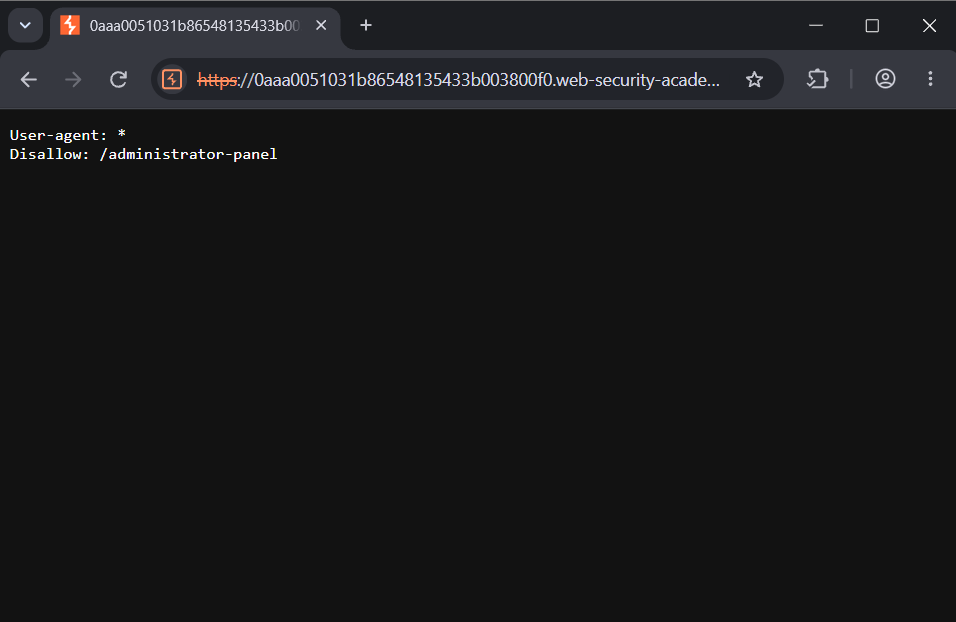
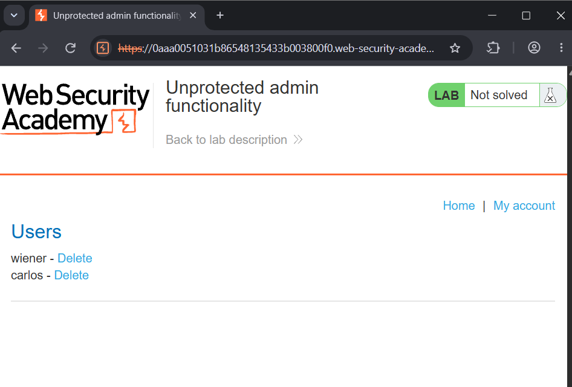
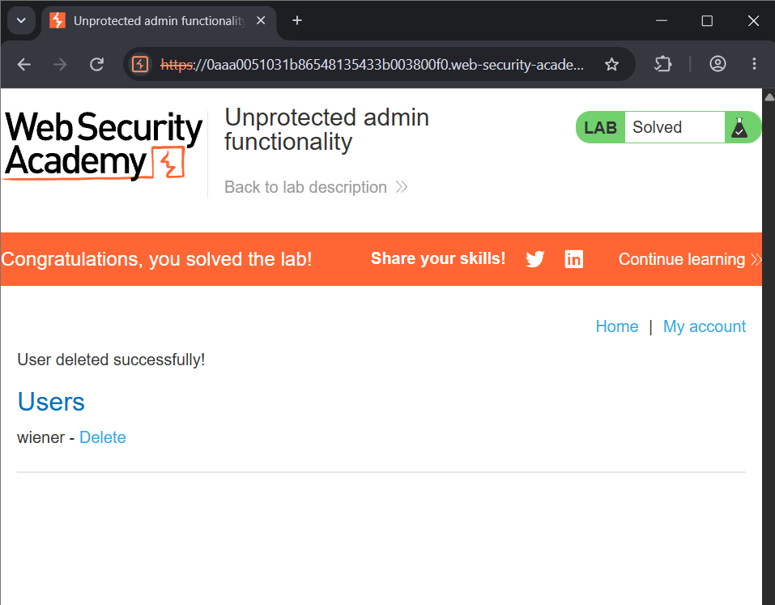

# Lab: Unprotected Admin Functionality

## 🎯 Objective
To find and access an unprotected admin panel, then delete the user `carlos` to solve the lab.

## 🛠️ Environment & Tools Used
- **Target:** PortSwigger Web Security Academy (Lab Instance)
- **Tool:** Web browser (no special tooling needed)
- **Difficulty:** Apprentice
- **Category:** Access Control

## 🔍 Vulnerability Analysis
The application has an admin panel that is not protected by any authentication or authorization check. The only "protection" is that the path is not linked anywhere on the site. However, the path is disclosed in the `robots.txt` file, which is publicly readable. Hiding a URL is not access control: anyone who finds the path can use the admin functionality.

## 💥 Exploitation Steps

### 1. Check `robots.txt`
I appended `/robots.txt` to the lab URL. The `Disallow` entry reveals the hidden admin panel path: `/administrator-panel`.

### 2. Access the Admin Panel
I replaced `/robots.txt` in the URL bar with `/administrator-panel`. The admin panel loaded without any login or role check, and it lists the users `wiener` and `carlos`.

### 3. Delete the User `carlos`
I clicked **Delete** next to `carlos`. The application responded with "User deleted successfully!" and the lab was marked as solved.

## 🛡️ Remediation (How to Fix)
1. **Enforce access control on the server:** Every admin function must verify that the current user is authenticated and has the admin role.
2. **Do not rely on obscurity:** Hiding a URL or leaving it out of the UI does not protect it.
3. **Avoid listing sensitive paths in `robots.txt`:** It is public and tells attackers exactly where to look.
4. **Deny by default:** Require explicit permission for every resource, so new endpoints are protected unless deliberately opened.

---
*Writeup by Tanmay Sarkar Emon*
