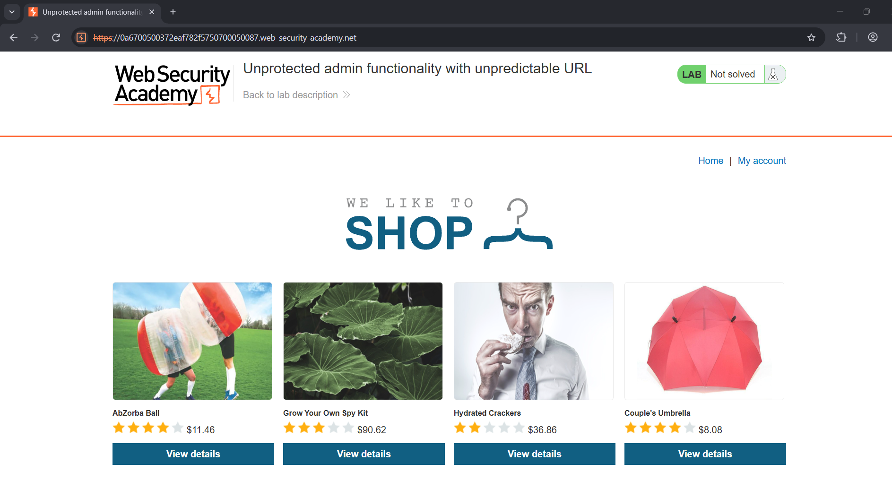
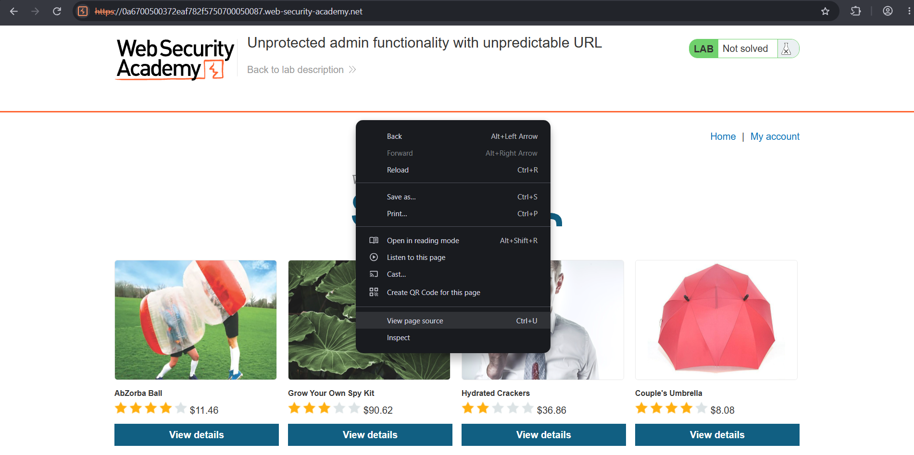
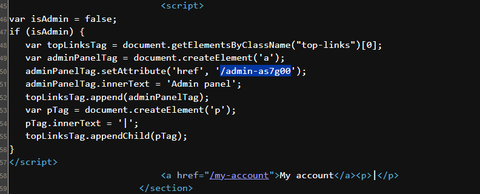
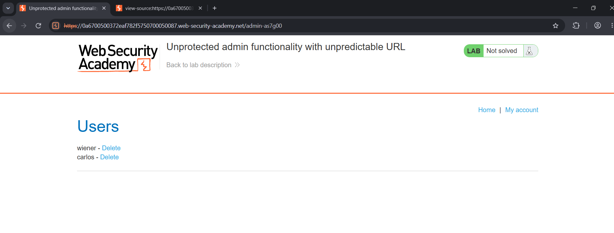

# Lab: Unprotected Admin Functionality with Unpredictable URL

## 🎯 Objective
To find the admin panel, which is hosted at an unpredictable URL that is disclosed somewhere in the application, and use it to delete the user `carlos`.

## 🛠️ Environment & Tools Used
- **Target:** PortSwigger Web Security Academy (Lab Instance)
- **Tool:** Web browser (View Page Source)
- **Difficulty:** Apprentice
- **Category:** Access Control

## 🔍 Vulnerability Analysis
The admin panel has no access control, and its only protection is a random-looking URL. That is security through obscurity. The URL is leaked in the JavaScript of the home page: the script builds an "Admin panel" link, but only runs it when `isAdmin` is true. Because this check happens in the browser, any visitor can read the script and see the hidden path.

## 💥 Exploitation Steps

### 1. Open the Lab Home Page
I opened the lab and looked for any visible link to an admin area. There was none.

### 2. View the Page Source
I right-clicked the page and chose **View page source** (`Ctrl+U`).

### 3. Find the Admin Path in the JavaScript
Searching the source for `admin`, I found a script that adds an "Admin panel" link when `isAdmin` is true. The script discloses the path `/admin-as7g00`.

### 4. Access the Admin Panel
I appended `/admin-as7g00` to the lab URL. The admin panel loaded without any login or role check and listed the users `wiener` and `carlos`.

### 5. Delete the User `carlos`
I clicked **Delete** next to `carlos`. The application confirmed
