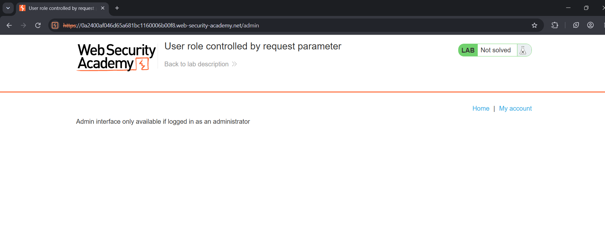
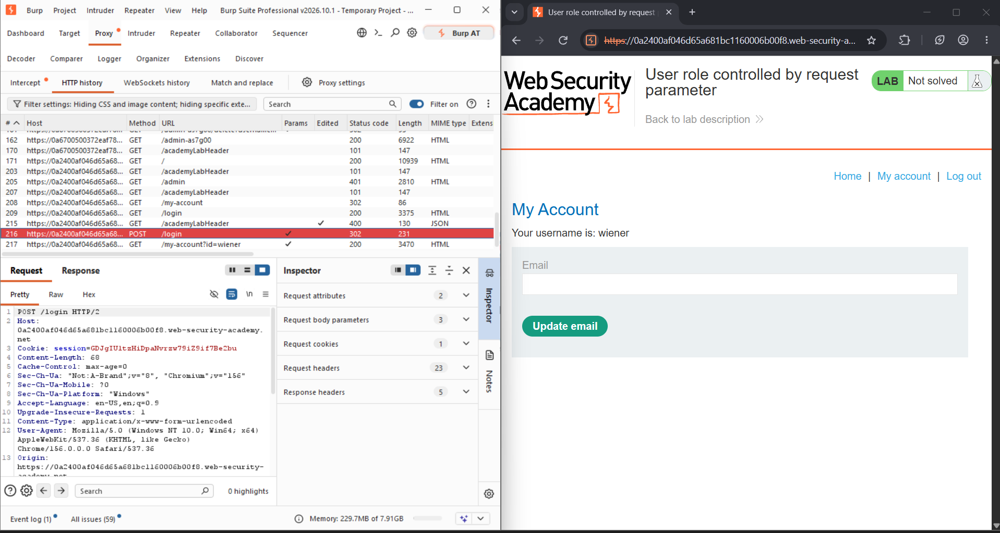
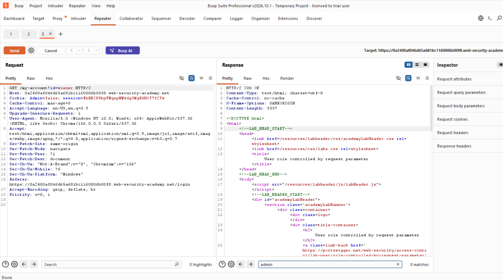
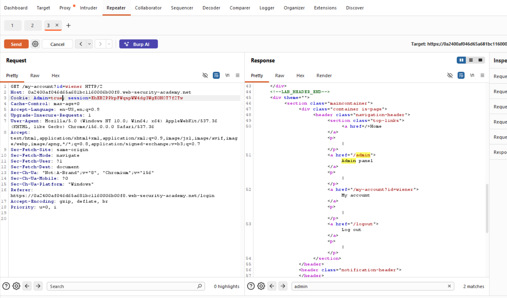
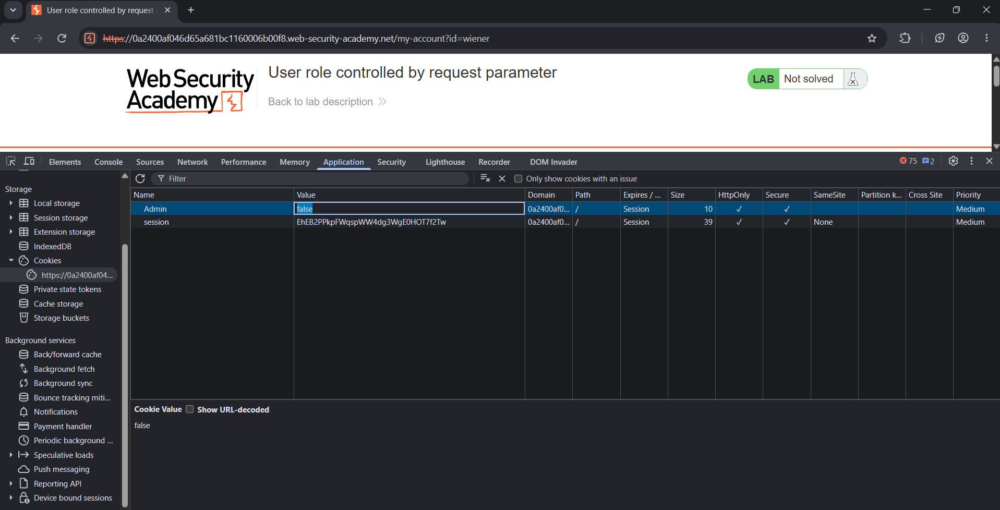
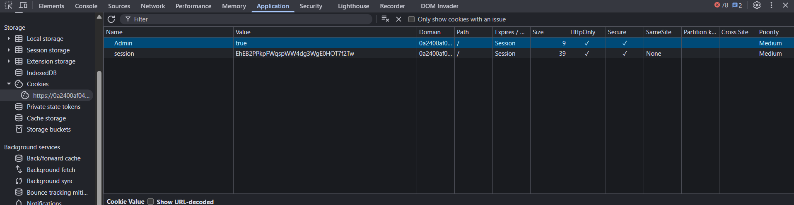
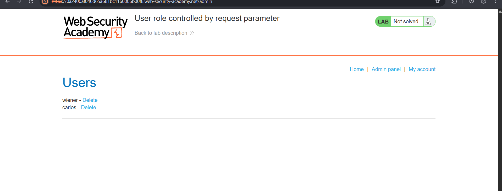
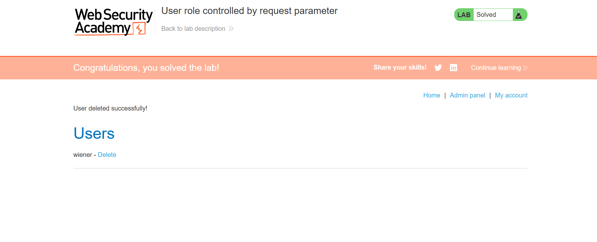

# Lab: User Role Controlled by Request Parameter

## 🎯 Objective
To access the admin panel at `/admin` by exploiting a forgeable cookie that decides whether a user is an administrator, then delete the user `carlos`.

## 🛠️ Environment & Tools Used
- **Target:** PortSwigger Web Security Academy (Lab Instance)
- **Tools:** Burp Suite Professional (Proxy & Repeater), Browser DevTools
- **Difficulty:** Apprentice
- **Category:** Access Control

## 🔍 Vulnerability Analysis
The application stores the user's role in a cookie named `Admin` (`Admin=false` for normal users). The server trusts this value to decide who can use the admin panel. Cookies are fully controlled by the client, so any user can change `false` to `true` and gain administrator access. This is a broken access control issue (vertical privilege escalation): the role decision is based on data the user can modify.

## 💥 Exploitation Steps

### 1. Try the Admin Panel Directly
I browsed to `/admin` without being logged in as an administrator. The application blocked access with the message "Admin interface only available if logged in as an administrator".

### 2. Log In and Capture Traffic
I logged in with my own account (`wiener`) while Burp Suite Proxy was running. The HTTP history shows the `POST /login` request followed by `GET /my-account?id=wiener`.

### 3. Inspect the Cookie in Repeater
I sent `GET /my-account?id=wiener` to **Repeater**. The request contains the cookie `Admin=false`, and the response has no link to an admin panel.

### 4. Change the Cookie to `Admin=true`
I changed the cookie value to `Admin=true` and sent the request again. The response now includes an **Admin panel** link pointing to `/admin`, which confirms the server trusts this cookie.

### 5. Modify the Cookie in the Browser
In the browser, I opened DevTools → **Application → Cookies** and found the `Admin` cookie set to `false`.

I edited the value to `true`.

### 6. Access the Admin Panel
I browsed to `/admin` again. This time the admin panel loaded and listed the users `wiener` and `carlos`.

### 7. Delete the User `carlos`
I clicked **Delete** next to `carlos`. The application confirmed "User deleted successfully!" and the lab was marked as solved.

## 🛡️ Remediation (How to Fix)
1. **Never trust client-controlled data for authorization:** Do not store roles or privileges in cookies, hidden fields, or URL parameters that the user can edit.
2. **Keep roles on the server:** Store the user's role in the server-side session or database and check it on every request to admin functions.
3. **Enforce access control on every endpoint:** Verify authentication and authorization at the server, not just by hiding links in the interface.
4. **Deny by default:** Require explicit permission for every resource.

---
*Writeup by Tanmay Sarkar Emon*
